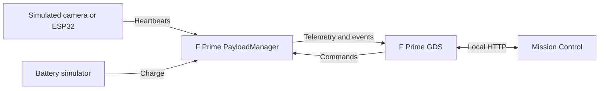

# CubeSat Flight Software Simulator

A CubeSat imaging simulator built with NASA JPL's F Prime framework. A single ground command schedules an imaging pass. The flight software waits for the target window, checks camera and battery health, and starts or skips the capture. Mission Control displays the orbit, frame count, and events reported by the flight software.

The orbit, target window, and captured frames are simulated. The camera heartbeat can come from either the simulator or an ESP32 on the local network.

## What the demo shows

- **Scheduled imaging.** The C++ payload manager advances a 26-second demonstration orbit. It can arm one capture for the next full target window, from 45° to 135°, and stops capture when the window closes or the frame limit is reached.
- **Fault handling.** A 500 ms camera heartbeat timeout or a battery reading of 20% or lower puts the payload in SAFE. Imaging stops, the frame count freezes, and telemetry continues. Mission Control marks the interruption on the orbit.
- **Recovery.** Three consecutive fresh camera heartbeats and a battery reading of at least 30% allow a ground operator to request recovery. A successful request returns the payload to Standby. The next capture requires a new command.
- **Incident analysis.** Mission Control can explain recent faults from recorded events with a local rules engine. An optional AI provider can select evidence for the report. The dashboard checks the cited events and the flight software retains command authority.

## Architecture



| Path | Role |
| --- | --- |
| `CubeSat/Components/PayloadManager/` | C++ imaging scheduler, SAFE transitions, and recovery checks |
| `CubeSat/Components/CameraSimulator/` | Simulated camera and optional ESP32 heartbeat input |
| `CubeSat/Components/BatterySimulator/` | Simulated battery readings and fault injection |
| `CubeSat/Satellite/` | F Prime deployment and topology |
| `mission_dashboard_pass.py` | Mission Control, automated fault trials, and incident reports |

## Run locally

The flight build was tested on Ubuntu under WSL with F Prime v4.4.2. Prepare the F Prime virtual environment and native build prerequisites using the [F Prime installation guide](https://fprime.jpl.nasa.gov/latest/docs/getting-started/installing-fprime/).

From the repository root, initialize the framework dependency and generate the native build cache:

```bash
git submodule update --init --recursive
source fprime-venv/bin/activate
fprime-util generate
```

In the same terminal, build the deployment and start the simulator:

```bash
cd CubeSat/Satellite
fprime-util build
env -u CUBESAT_USE_ESP32 -u CUBESAT_ESP32_IP fprime-gds
```

Leave GDS running. From the repository root in a second terminal, start Mission Control:

```bash
python3 mission_dashboard_pass.py --port 8081
```

Open [Mission Control](http://127.0.0.1:8081). The dashboard uses Python's standard library and connects to GDS on port 5000.

### Demo a normal pass and a fault

1. Set the capture limit to **20**. Click **Capture next pass** and watch the status move from **Waiting for next pass** to **Capturing target** to **Pass complete**.
2. Arm another pass. As soon as **Capturing target** appears, click **Simulate camera fault**. Check for **SAFE**, a frozen frame count, and an orange track ending at the point where capture stopped.
3. Click **Restore simulated camera**. Once the recovery counter reaches **3/3** and the battery is at least **30%**, click **Request recovery**. Verify that the payload returns to **Standby**.

### Use an ESP32 heartbeat source

Connect the ESP32 and the host to the same local network. With the heartbeat firmware running, restart GDS from `CubeSat/Satellite/`:

```bash
read -r -p 'ESP32 IP from Serial Monitor: ' esp32_ip
CUBESAT_USE_ESP32=1 CUBESAT_ESP32_IP="$esp32_ip" fprime-gds
```

The firmware listens on UDP port `4210`. It starts sending numbered heartbeats to the client that sends an ASCII `H`. Check for an increasing heartbeat number in Mission Control before testing a hardware disconnect.

## Verification

With GDS running in simulation mode, run the automated camera-fault test from the repository root:

```bash
python3 mission_dashboard_pass.py --verify --trials 3
```

The harness checks that frames advance with a healthy camera, freeze in SAFE, and stay stopped after recovery to Standby. It writes a CSV, a JSON summary, and incident replays. In one three-trial simulator run, the logged times from the last accepted heartbeat to SAFE were **600 ms, 500 ms, and 500 ms**. These are millisecond-resolution simulator observations. Hardware timing and scheduled-pass behavior are separate checks.

For optional AI incident analysis, set `CUBESAT_AI_PROVIDER`, `CUBESAT_AI_MODEL`, and the matching `OPENAI_API_KEY` or `ANTHROPIC_API_KEY` in the dashboard process's environment. **Explain with rules** works offline. **Explain with AI** sends selected diagnostic events to the configured provider.
